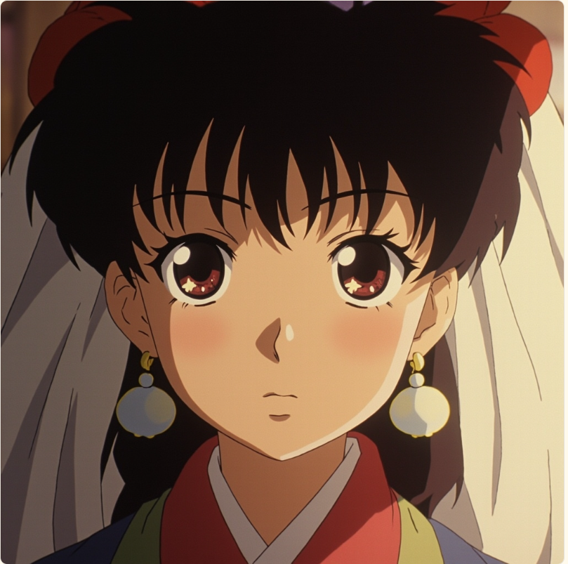
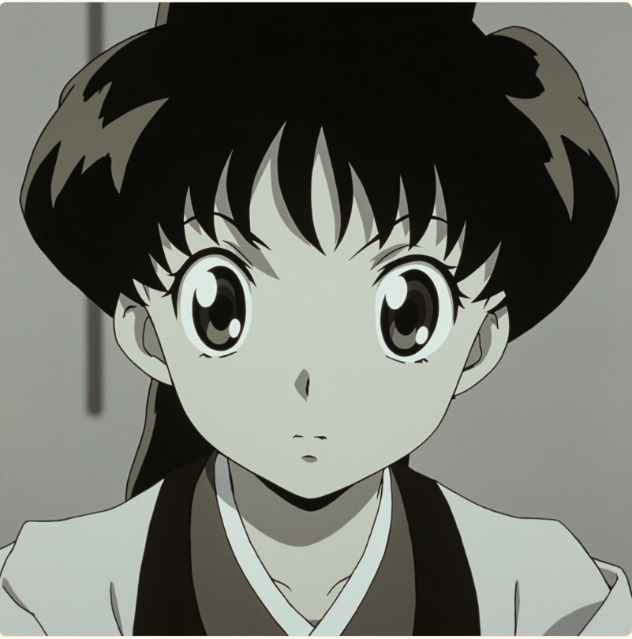

# Estilo: Anime retrô anos 90

Exemplo de referência para o Claude ajustar o código de geração de prompt/imagem deste estilo.

## Variações de cor

| Variação                     | Trecho do prompt              |
| ---------------------------- | ----------------------------- |
| Colorida                     | `Warm color palette`          |
| Preto e branco (cinza)       | `Black and white monochrome`  |

## Imagens geradas

### Colorida — `Warm color palette`



### Preto e branco (cinza) — `Black and white monochrome`



## Prompt usado

```
1990s anime style portrait, close-up of a {faixa_etaria} {etinia} {sexo}, front view, centered composition. {cabelo}. Very large expressive anime eyes with big bright catchlight reflections, thick defined eyelashes, small minimalist nose, tiny neutral mouth. Classic 90s cel shaded anime aesthetic, soft lines, nostalgic vintage anime look. {paleta_cor}
```

O placeholder `{paleta_cor}` recebe um dos trechos da tabela acima:

- **Colorida:** `Warm color palette`
- **Preto e branco (cinza):** `Black and white monochrome`

## Placeholders

| Placeholder      | Significado                |
| ---------------- | -------------------------- |
| `{faixa_etaria}` | Faixa etária do personagem |
| `{etinia}`       | Etnia                      |
| `{sexo}`         | Sexo                       |
| `{cabelo}`       | Descrição do cabelo        |
| `{paleta_cor}`   | Variação de cor (ver acima) |

## Parâmetros

- `aspect_ratio`: `1:1`
- `resolution`: `2K`
