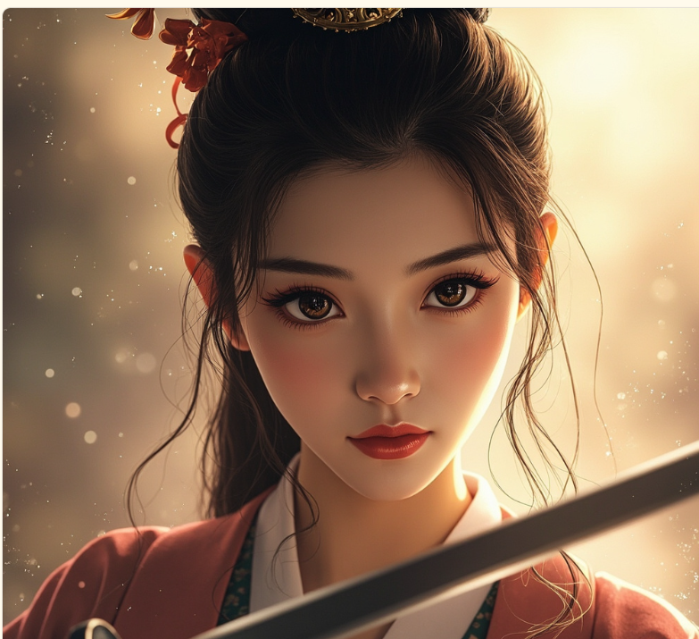
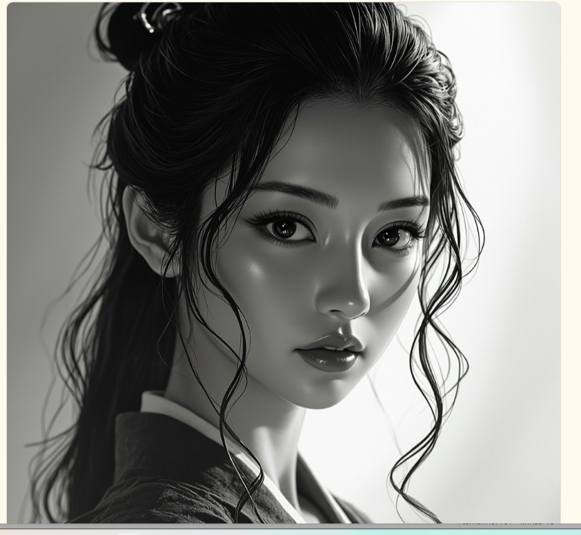

# Estilo: Dark fantasy semi-realista

Exemplo de referência para o Claude ajustar o código de geração de prompt/imagem deste estilo.

## Variações de cor

| Variação                     | Trecho do prompt              |
| ---------------------------- | ----------------------------- |
| Colorida                     | `Warm color palette`          |
| Preto e branco (cinza)       | `Black and white monochrome`  |

## Imagens geradas

### Colorida — `Warm color palette`



### Preto e branco (cinza) — `Black and white monochrome`



## Prompt usado

```
Photorealistic cinematic portrait, close-up of a {faixa_etaria} {etinia} {sexo}, 3/4 view. {cabelo}. Large expressive eyes with defined lashes, thin arched eyebrows, smooth skin. Cinematic lighting with sharp focus on the face, soft bokeh background, semi-3D digital painting aesthetic, high detail. {paleta_cor}
```

O placeholder `{paleta_cor}` recebe um dos trechos da tabela acima:

- **Colorida:** `Warm color palette`
- **Preto e branco (cinza):** `Black and white monochrome`

## Placeholders

| Placeholder      | Significado                 |
| ---------------- | --------------------------- |
| `{faixa_etaria}` | Faixa etária do personagem  |
| `{etinia}`       | Etnia                       |
| `{sexo}`         | Sexo                        |
| `{cabelo}`       | Descrição do cabelo         |
| `{paleta_cor}`   | Variação de cor (ver acima) |

## Parâmetros

- `aspect_ratio`: `1:1`
- `resolution`: `2K`
