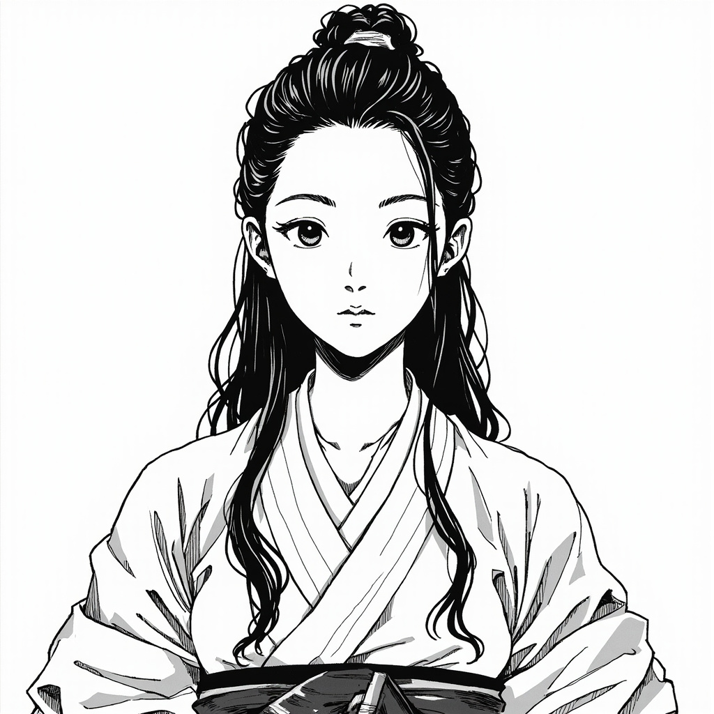
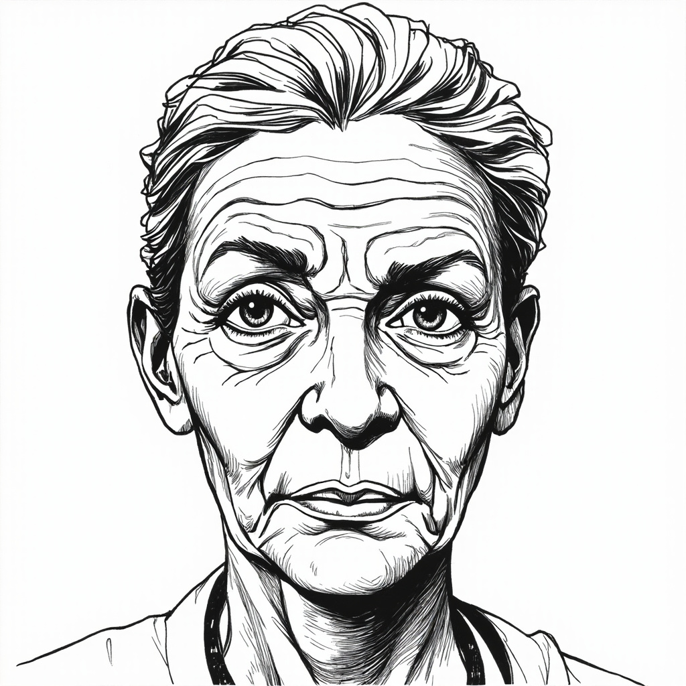

# Estilo: Manga PB (preto e branco)

Exemplo de referência para o Claude ajustar o código de geração de prompt/imagem deste estilo.

## Imagens geradas





## Prompt usado

```
Black and white manga style sketch portrait of a {faixa_etaria} {etinia} {sexo}, front-facing view, has {cabelo},  Large expressive anime eyes, {caracteristicas}, {expressao}. Clean line art style, thin precise lines, minimal shading, no screentones, plain white background, manga panel aesthetic, monochrome, no color, high contrast black ink on white paper, sketch illustration style
```

## Placeholders

| Placeholder      | Significado                          |
| ---------------- | ------------------------------------ |
| `{faixa_etaria}` | Faixa etária do personagem           |
| `{etinia}`       | Etnia                                |
| `{sexo}`         | Sexo                                 |
| `{cabelo}`       | Descrição do cabelo                  |
| `{caracteristicas}` | Características faciais marcantes  |
| `{expressao}`    | Expressão facial                     |

## Parâmetros

- `aspect_ratio`: `1:1`
- `resolution`: `2K`
